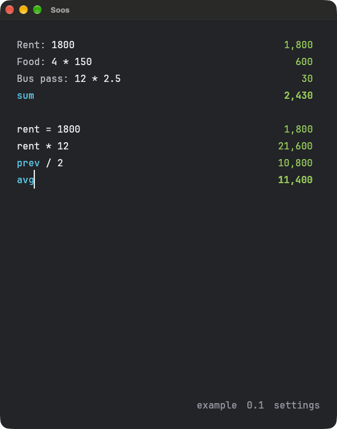

<div align="center">


# Soos

A calculator you type into like a notepad, for Windows, macOS, Linux and
Android: each line is a calculation, and its answer shows beside it.

[](https://github.com/thuocke/soos/releases/latest/download/soos-windows-x86_64.zip)
[](https://github.com/thuocke/soos/releases/latest/download/Soos.dmg)
[](https://github.com/thuocke/soos/releases/latest/download/soos-linux-x86_64.tar.gz)
[](https://github.com/thuocke/soos/releases/latest/download/soos-android.apk)

Windows 64-bit (Intel or AMD) · macOS (Apple silicon or Intel) · Linux
64-bit (Intel or AMD) · Android 8 or newer (64-bit)



[](https://github.com/thuocke/soos/actions/workflows/ci.yml)
[](https://github.com/thuocke/soos/releases/latest)
[](LICENSE)

</div>

## Download

| Platform | How |
|---|---|
| Windows | Download [`soos-windows-x86_64.zip`](https://github.com/thuocke/soos/releases/latest/download/soos-windows-x86_64.zip), extract it to a folder you'll keep, and run `soos-app.exe`. Soos saves your tabs in a `data` folder beside it. |
| macOS | Download [`Soos.dmg`](https://github.com/thuocke/soos/releases/latest/download/Soos.dmg) and drag Soos to Applications. Or run `brew install --cask thuocke/tap/soos`, which also puts `soos-cli` on your `PATH`. |
| Linux | Download [`soos-linux-x86_64.tar.gz`](https://github.com/thuocke/soos/releases/latest/download/soos-linux-x86_64.tar.gz), extract it to a folder you can write to, and run `soos-app`. |
| Android | Download [`soos-android.apk`](https://github.com/thuocke/soos/releases/latest/download/soos-android.apk) and open it. Allow your browser or Files app to install apps when Android asks. Soos isn't on Google Play. |

Soos isn't signed yet, so Windows and macOS warn you the first time you open
it: [Install Soos](docs/install-help.md) has the steps past the warning.
Later, see [Update Soos](docs/update.md) and
[Uninstall Soos](docs/uninstall.md).

## Quick guide

You will add up three costs, then work out a year's rent from a variable.

1. Open Soos and type these four lines. Each answer shows on the right.

       Rent: 1800                     1,800
       Food: 4 * 150                    600
       Bus pass: 12 * 2.5                30
       sum                            2,430

   `Rent:` is a label, so only what follows it is calculated, and `sum`
   adds up the lines above it.
2. Leave a blank line, which starts a new block, then type four more.

       rent = 1800                    1,800
       rent * 12                     21,600
       prev / 2                      10,800
       avg                           11,400

   `rent = 1800` makes a variable for the lines below, `prev` is the result
   above, and `avg` averages its block.
3. Click `11,400` to copy it. It pastes as `11400`.

Next: [Totals and variables](docs/totals.md) · [The app](docs/the-app.md)

## Features

Soos calculates with [fend](https://github.com/printfn/fend) and adds rules
of its own.

- [Totals and variables](docs/totals.md): labels, `sum`, `avg`, `prev`, and
  notes in plain words between the calculations.
- [Phrases](docs/phrasing.md): `5% on 30`, `4 plus 4`, `20% of what is 30`.
- [Currency](docs/money-and-units.md): `$8 * 3` and `20 EUR in USD`, with
  rates saved for offline use. Amounts
  [round](docs/money-and-units.md#rounding) to the currency's usual
  decimals, and `≈` marks a result that isn't exact.
- [Units](docs/money-and-units.md#units): `20 inches in cm`, `20 sq cm`,
  `5 ft 11 in`.
- [Your own units](docs/money-and-units.md#your-own-converters): one line
  each, such as `1 lap = 400 m`, on a page kept apart from your text.
- [Dates and time zones](docs/dates-and-time.md): `today + 3 days`,
  `3pm PST in Tokyo`. Write a date as `@2026-12-25`.
- [Decimal comma](docs/the-app.md#decimal-comma): click `0.1` in the status
  bar, and `3,5 + 1` is `4,5`.
- [Tabs](docs/the-app.md#tabs): up to 9 scratchpads, saved when you close
  Soos.
- [Tray icon and hotkey](docs/the-app.md#tray-dock-and-hotkey): bring Soos
  up from any app on Windows and macOS.
- [Android](docs/the-app.md#on-android): the same engine and rules, on a
  touch screen.
- [`soos-cli`](docs/soos-cli.md): `soos-cli '20 inches in cm'` prints
  `50.8 cm` in a terminal or a script.
- [PowerToys Run](docs/powertoys.md): type `=20 inches in cm` there, on
  Windows. You build the plugin from this repository.

Soos goes online for two things and sends no user data with either: it
refreshes exchange rates, and on a desktop it checks for a new version when
you click **Version** in `settings`.

## Docs

[The guide](docs/README.md) lists every page, with an example for each.

## Build from source

Install Rust 1.95 or newer, then:

```
git clone https://github.com/thuocke/soos.git
cd soos
cargo build --release -p soos-app -p soos-cli
```

The programs are `target/release/soos-app` and `target/release/soos-cli`.
[CONTRIBUTING.md](CONTRIBUTING.md) covers the Linux build dependencies, the
Android app, the checks CI runs and the release process.

## Contributing, security and license

- Contributing: open pull requests against `dev`, as
  [CONTRIBUTING.md](CONTRIBUTING.md) describes.
- Security: report a vulnerability privately, as [SECURITY.md](SECURITY.md)
  describes.
- License: [MIT](LICENSE). Soos is built on
  [fend](https://github.com/printfn/fend) and
  [egui/eframe](https://github.com/emilk/egui). The typeface is
  [JetBrains Mono](https://www.jetbrains.com/lp/mono/) under the
  [SIL Open Font License 1.1](assets/fonts/OFL.txt), with currency signs
  from [DejaVu Sans Mono](https://dejavu-fonts.github.io/) under
  [its license](assets/fonts/DejaVu-LICENSE.txt). Exchange rates come from
  [Frankfurter](https://frankfurter.dev). The idea comes from
  [Numi](https://github.com/nikolaeu/numi).
