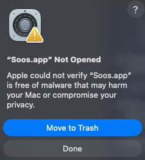

# Install Soos

You have the download for your system from the
[latest release](https://github.com/thuocke/soos/releases/latest). The
builds aren't code-signed yet, so Windows and macOS warn you the first time
you open Soos; the steps below include the way past the warning.

## Windows

1. Right-click `soos-windows-x86_64.zip`, then click **Extract All**.
2. Choose a folder you'll keep. Soos saves your tabs and settings in a
   `data` folder beside the program.
3. Run `soos-app.exe` from the extracted `soos-windows-x86_64` folder.
   Windows shows "Windows protected your PC": that is SmartScreen, for an
   unsigned app.
4. Click **More info**, then **Run anyway**.

If you want `soos-cli` in a terminal too: see
[Put soos-cli on your PATH](soos-cli-path.md#windows).

## macOS

1. Open `Soos.dmg` and drag Soos to Applications.
2. Open Soos from Applications. macOS shows this, because the app isn't
   signed; the download is fine.

   

3. Click **Done**, not **Move to Trash**.
4. Open Terminal: press Cmd+Space, type `Terminal`, press Return.
5. Run this, which removes the "downloaded from the internet" mark:

   ```
   xattr -cr /Applications/Soos.app
   ```

6. Open Soos again.

If macOS says "Soos is damaged and can't be opened": that is the same
warning on an older macOS, and the same steps work.
If you moved Soos out of Applications: use its real path in step 5.
If you use [Homebrew](https://brew.sh): run
`brew install --cask thuocke/tap/soos` in place of every step above. It
clears the mark for you and links `soos-cli`.

Your tabs and settings are kept in `~/Library/Application Support/Soos/`.

## Linux

1. Extract the archive into a folder you can write to, such as
   `~/.local/opt`. Soos saves your tabs and settings in a `data` folder
   beside the program.

   ```
   mkdir -p ~/.local/opt
   tar xzf soos-linux-x86_64.tar.gz -C ~/.local/opt
   ```

2. Run `~/.local/opt/soos-linux-x86_64/soos-app`.

If you want Soos in your applications menu: give the archive's
`soos.desktop` the real paths and copy it into place.

```
d=~/.local/opt/soos-linux-x86_64
mkdir -p ~/.local/share/applications
sed "s|^Exec=.*|Exec=$d/soos-app|; s|^Icon=.*|Icon=$d/soos.png|" \
  "$d/soos.desktop" > ~/.local/share/applications/soos.desktop
```

If you want `soos-cli` in a terminal too: see
[Put soos-cli on your PATH](soos-cli-path.md#linux).

## Android

Soos needs Android 8 or newer on a 64-bit phone.

1. Open `soos-android.apk` from your browser's download notice or the Files
   app.
2. Android asks you once to let that app install apps: the setting is
   called "Install unknown apps". Allow it and go back.
3. Tap **Install**.
4. Open Soos from your apps. Your tabs and settings stay inside the app.

Soos isn't on Google Play, so Android doesn't update it for you: see
[Update Soos](update.md#android).

See also: [Update Soos](update.md) · [Uninstall Soos](uninstall.md)
