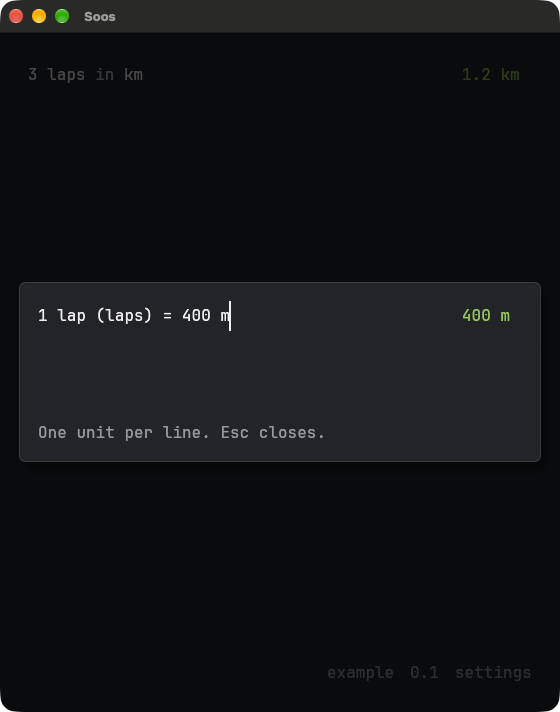

# Add your own converter

You have Soos open. A converter is a unit you name, in terms of one Soos
already knows.

1. Click `settings` in the status bar, then **Your converters**. A page
   opens over your text.
2. Type `1 lap (laps) = 400 m`. Beside the line you see `400 m`.
3. Press Esc to close the page.
4. Type `3 laps in km`. You see `1.2 km`.

If you are on Android: tap **Done** in step 3.
If the line shows an error label where `400 m` should be:
[Your own converters](money-and-units.md#your-own-converters) says what each
label means.
If you use `soos-cli`: it picks the converter up once the page is closed.

See also: [Your own converters](money-and-units.md#your-own-converters)
