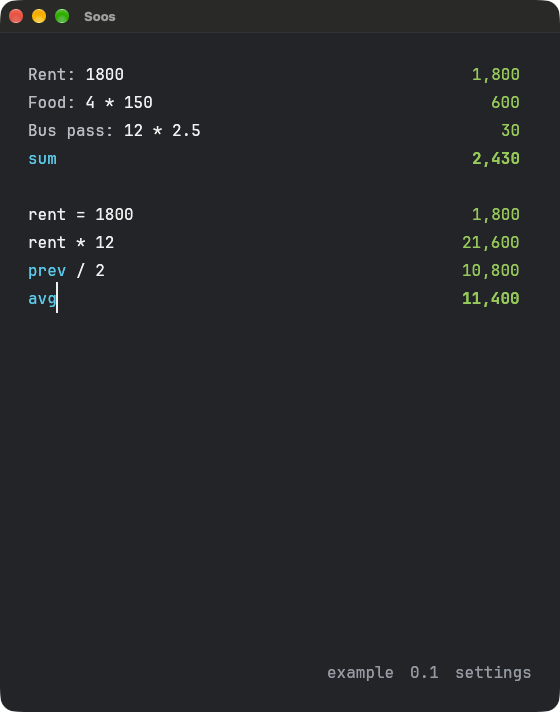
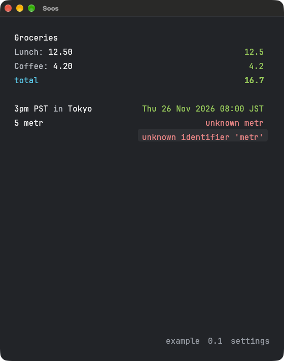
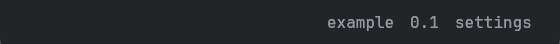
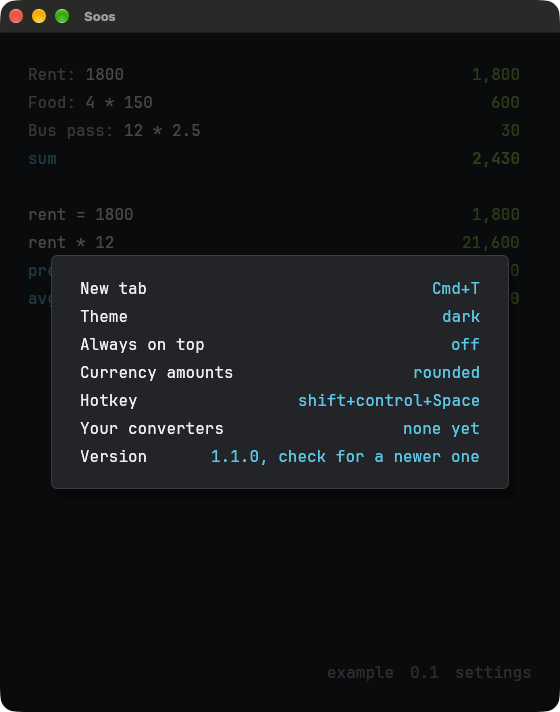
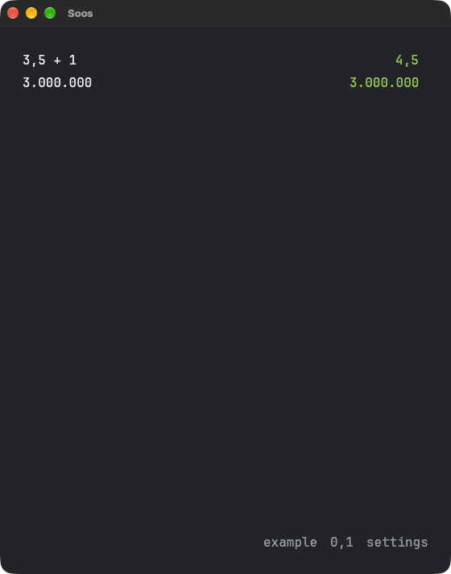

# The app

The window, part by part: tabs, the result column, the status bar and its
settings, the decimal comma, the tray icon and hotkey, what differs on
Android, and every error label.

## Tabs

Soos holds up to 9 tabs, each its own scratchpad. It saves their text when
you close it and brings it back next time. The tab strip shows once there
are two tabs.

| To | Do |
|---|---|
| Add a tab | Press Cmd/Ctrl+T, click `settings` then **New tab**, or click `+` in the tab strip |
| Close a tab | Click the `×` on it, middle-click it, or press Cmd/Ctrl+W |
| Bring back the last one you closed | Cmd/Ctrl+Shift+T |
| Switch | Cmd/Ctrl+1-9, or Ctrl+Tab and Ctrl+Shift+Tab |
| Zoom the text | Cmd/Ctrl and `+` or `-`; Cmd/Ctrl and `0` resets it |

## The result column

| What you see | Means |
|---|---|
| A result at the column's right edge | The line's answer. Click it to [copy it](#copying-a-result) |
| A result in bold | A total: `sum`, `total`, `avg` or `average` |
| A result that runs left of the column | It is longer than the column, and its line leaves room |
| A result that ends in `…` | It is too long even for that room. Hover over it to read it all |
| A short red label, such as `unknown metr` | An error. Click it to show the full message under the line, and again to hide it; hovering shows it too. [Error labels](#error-labels) says what each means |
| No result and no error | A blank line, a heading, a comment, or a note: a line of words with nothing to calculate |
| No error on the line you're typing | An error there waits until you pause |
| Dimmed results | A slow document is still calculating. The old results stay until the new ones are ready, and typing is never held up |

### Copying a result

Click a result to copy it without thousands separators: `$1,234,567.89`
copies as `$1234567.89`. It pastes back into Soos as the same amount. With
the [decimal comma](#decimal-comma) on, it copies in that form:
`$1.234.567,89` copies as `$1234567,89`.

## The status bar

On the right, left to right:

| Word | Does |
|---|---|
| `example` | Shows a worked example, which also opens the first time you start Soos. A click or Esc closes it |
| `0.1` `0,1` | Decimal mark: a point or a comma. Click to switch; see [Decimal comma](#decimal-comma) |
| `settings` | Opens the settings below |

Each setting is a row with its name on the left and its value on the
right. Click a row to change it, or move to it with Tab and press Enter.
Esc or a click outside closes the list.

| Setting | Does |
|---|---|
| New tab | Adds a tab |
| Theme | Same as the system, light or dark. Each click moves to the next |
| Always on top | Keeps the window above other windows |
| Currency amounts | `rounded`, or `every digit`, which also shows 10 decimals of a `≈` result |
| Hotkey | Sets the global hotkey: click it, then press the new key |
| Your converters | Opens [your converters](money-and-units.md#your-own-converters) |
| Version | Shows the version. Click it to check for a newer one; the answer shows in the status bar |

The bar also shows:

- `rates offline` until the first exchange rates arrive;
- `rates 2 days old` (for example) once the saved rates are more than a day
  old.

## Decimal comma

By default `,` groups thousands and `.` is the decimal mark, so `3,000,000`
is three million and `1,5` is 15. Clicking `0.1` in the status bar
switches the marks: it turns into `0,1`, `,` becomes the decimal mark and
`.` groups thousands, so `3,5 + 1` is `4,5` and `3.000.000` is three
million. Clicking `0,1` switches back.

- It is one setting for the whole app, saved with your tabs: it covers every
  tab and stays on after a restart.
- Results follow the setting too, and so does a converter's factor.
- Only how numbers are read and shown changes: the document is saved as you
  typed it.
- `soos-cli` always reads and prints a point: `1,234.5`.

## Tray, Dock and hotkey

A tray icon (the menu bar on macOS): click it to show the window,
right-click it for Quit.

| | Windows | macOS | Linux |
|---|---|---|---|
| Closing the window | hides it to the tray | minimizes it; the Dock icon brings it back | quits |
| Global hotkey shows and hides it | Calculator key | Ctrl+Shift+Space; hiding also removes the Dock icon | none |
| Always on top | yes | yes | none |

- To change the hotkey, click `settings`, then **Hotkey**, then press the
  new key.
- If the tray icon fails to appear on Windows or macOS, closing the window
  quits instead of hiding it.

### Linux

- Wayland can't do a global hotkey, always-on-top or hiding to the tray, so
  Soos turns all three off on every Linux desktop, X11 included.
- Some desktops (GNOME without an AppIndicator extension) show no tray at
  all.

## On Android

The same engine and the same rules, so every page of this guide applies. What
differs is the touch screen.

- Tap a result to copy it. Tap an error to read its full message. Either
  appears in a note over the bottom of the page.
- The result column is at most 40% of the screen wide. A result too long for
  it ends in `…`; tap it, and the note shows all of it as it's copied.
- Close a tab with the `×` on it. An **Undo** bar brings it back for a few
  seconds; there is no Cmd/Ctrl+Shift+T.
- The status bar has `0.1` and `settings`, as on a desktop. The settings
  are **New tab**, **Currency amounts**, **Your converters** and the
  version. The theme follows the system. There is no example, update
  check, hotkey, tray icon or always-on-top.
- Exchange rates refresh when you open Soos.
- Your tabs stay on the phone, as on a desktop: they aren't part of
  Android's cloud backup, and they don't move to a new phone with Android's
  setup tools.

## Error labels

The labels this guide mentions, as Soos shows them. The converter labels
show on the converters page, the others beside the line.

| Label | Means | More |
|---|---|---|
| `unknown` and a name (`unknown metr`) | A name Soos doesn't know beside a number: a typo, a label used as a variable, or a variable not set yet. Words alone are a [note](totals.md#notes) | [Totals and variables](totals.md) |
| `can't compute` | The calculation failed, such as `-5 mod 3`; click the label for the reason | [Code operators](phrasing.md#code-operators) |
| `unit mismatch` | Two units that don't convert: `5 m + 1 kg` | [Units](money-and-units.md#units) |
| `no rates yet` | A conversion between currencies before the first exchange rates arrive | [Exchange rates](money-and-units.md#exchange-rates) |
| `invalid unit name` | A converter name that isn't letters, digits and `_` | [Your own converters](money-and-units.md#your-own-converters) |
| `unit name reserved` | A converter named like a built-in word | [Your own converters](money-and-units.md#your-own-converters) |
| `name already taken` | A converter name Soos or an earlier line already uses | [Your own converters](money-and-units.md#your-own-converters) |
| `base power too large` | A converter base with a power over 6 | [Your own converters](money-and-units.md#your-own-converters) |
| `needs on or off` | A percent before an amount, or in a variable beside one: `15% + $100` | [Plus and minus a percent](phrasing.md#plus-and-minus-a-percent) |
| `not a percent` | `on` or `off` after a name that doesn't hold a percent | [Percent](phrasing.md#percent) |
| `needs a whole number` | A root that isn't whole: `root 2.5 (27)` | [Functions](phrasing.md#functions) |
| `too large` | A shift over 100,000 places or a power over 10,000 | [Limits](phrasing.md#limits) |
| `too complex` | A calculation fend stops, such as `9999999!`, or a line that runs longer than 2 seconds | [Limits](phrasing.md#limits) |
| `calls itself` | A function that calls itself: `f = \x. f(x)` | [Limits](phrasing.md#limits) |
| `too nested` | Brackets, or functions called inside each other, nested too deeply | [Limits](phrasing.md#limits) |
| `needs a number` | A power of a unit inside a function, when the power isn't a number: `\x. x^y` | [Limits](phrasing.md#limits) |
| `no dice` | Dice such as `4d6` | [Limits](phrasing.md#limits) |
| `error on line 4` (any number) | `sum` or `avg` of a block with an error on that line of the page | [How sum and avg count](totals.md#how-sum-and-avg-count) |
| `percent in block` | `sum` of amounts and percents together | [How sum and avg count](totals.md#how-sum-and-avg-count) |
| `nothing to average` | `avg` of an empty block | [How sum and avg count](totals.md#how-sum-and-avg-count) |
| `too many lines` | A block too long to add up | [How sum and avg count](totals.md#how-sum-and-avg-count) |
| `nothing above` | `prev` with no result on a line above it | [Variables and prev](totals.md#variables-and-prev) |
| `reserved name` | A variable named like a built-in word: `sum = 5` | [Names you can't use](totals.md#names-you-cant-use) |
| `name in use` | A variable named like a unit or constant: `m = 5` | [Names you can't use](totals.md#names-you-cant-use) |
| `date needs @` | A date written without `@`: `2026-12-25` | [Writing a date](dates-and-time.md#writing-a-date) |
| `date out of range` | A date moved past the years 1 to 9999 | [Writing a date](dates-and-time.md#writing-a-date) |
| `no time of day` | Minutes or hours added to `today`: `today + 2 hours` | [Today and now](dates-and-time.md#today-and-now) |
| `needs a unit` | A bare number added to a time: `3PM + 2` | [Times of day](dates-and-time.md#times-of-day) |
| `unsupported time` | Anything else done to a time of day: `3PM * 2` | [Times of day](dates-and-time.md#times-of-day) |
